# 🧾 Phần Mềm Quản Lý Bán Hàng & Hóa Đơn (Billing Software)

<p align="center">
  <b>Hệ thống POS (Point of Sale) & Quản lý bán hàng Fullstack hiện đại</b><br>
  Tích hợp thanh toán <b>VietQR PayOS</b> tự động, quản lý kho <b>Sổ cái (Inventory Ledger)</b>, phân quyền <b>RBAC</b> và kiểm toán hoạt động <b>(Audit Trail)</b>.
</p>

<p align="center">
  
  
  
  
  
  
  
  
  
</p>

---

## 📸 Trực quan Giao diện Hệ thống (UI Showcase)

Dưới đây là các hình ảnh giao diện thực tế của dự án, giúp bạn nhanh chóng có cái nhìn toàn diện về luồng vận hành và các tính năng:

### 1. 🛍️ Bán hàng nhanh tại quầy (POS - Point of Sale)
Giao diện bán hàng được tối ưu hóa cho thu ngân: tra cứu món nhanh chóng, bộ lọc danh mục trực quan, giỏ hàng tự động cập nhật thời gian thực, hỗ trợ nhiều biến thể và nhóm tùy chọn (Topping/Size).

| 🖥️ Màn hình Bán hàng POS | 🎛️ Tùy chọn Biến thể & Topping |
| :---: | :---: |
| 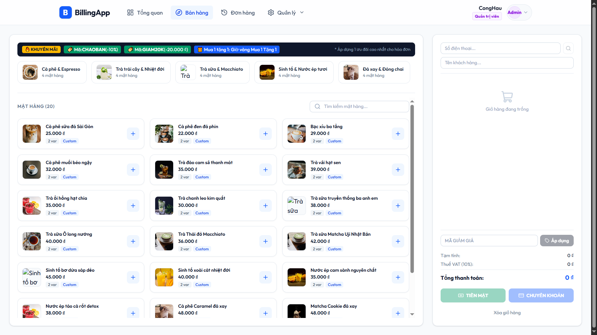 | 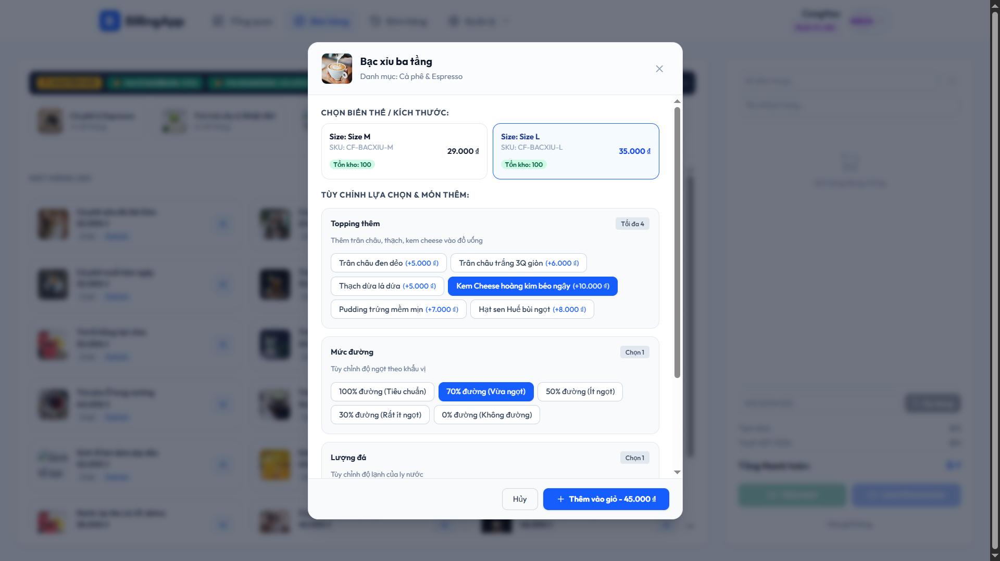 |
| *Giao diện bán hàng trực quan, chọn món và tính tiền siêu tốc* | *Popup tùy chọn linh hoạt kích cỡ (Size), độ ngọt, đá và topping* |

---

### 2. 💳 Thanh toán thông minh VietQR (PayOS) & In Hóa đơn
Tự động sinh mã VietQR động theo từng hóa đơn qua cổng PayOS. Hệ thống tự động xác nhận thanh toán qua Webhook thời gian thực và hỗ trợ xuất mẫu hóa đơn bán lẻ chuẩn in nhiệt 80mm.

| 📲 Quét mã thanh toán VietQR (PayOS) | 🧾 Mẫu hóa đơn bán lẻ in nhiệt (80mm) |
| :---: | :---: |
| 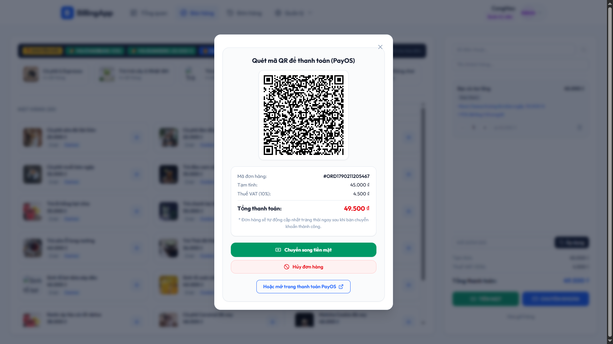 | 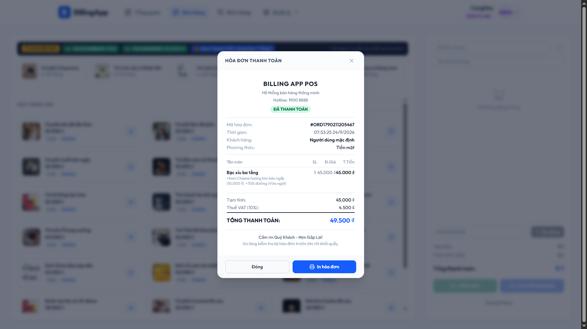 |
| *Tạo mã VietQR động kèm thông tin chuyển khoản chính xác tuyệt đối* | *Hóa đơn chi tiết danh sách món, phụ thu topping, giảm giá và thuế* |

---

### 3. 📊 Dashboard Thống kê & Quản trị Tồn kho Sổ cái (Ledger)
Trang chủ trực quan hiển thị KPI doanh số, đơn hàng và biểu đồ kinh doanh. Hệ thống kiểm soát tồn kho theo mô hình sổ cái (Ledger Inventory) ghi vết mọi giao dịch nhập, xuất và kiểm kê.

| 📈 Bảng điều khiển Doanh số (Dashboard) | 📦 Thao tác Sổ cái Nhập / Xuất kho |
| :---: | :---: |
| 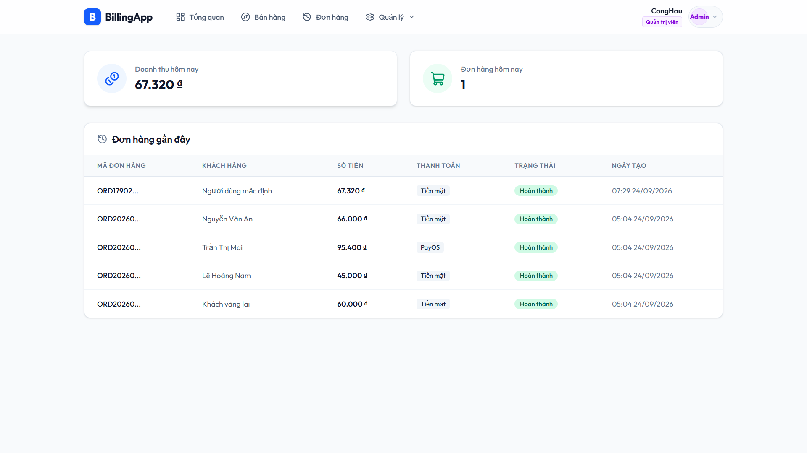 | 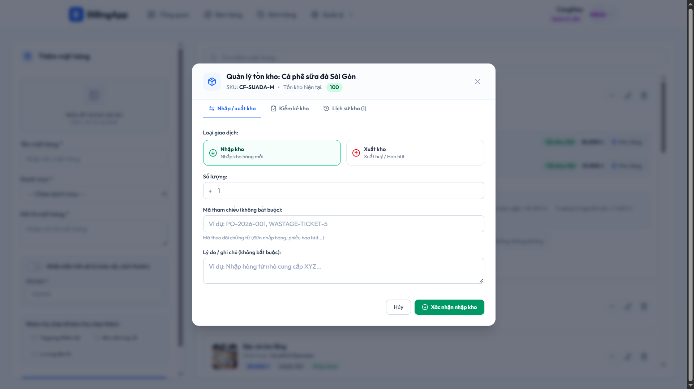 |
| *Theo dõi doanh thu thực tế, số lượng đơn, khách hàng mới và biểu đồ* | *Ghi nhận giao dịch IN/OUT/ADJUSTMENT và đối soát cân bằng kho* |

---

### 4. 📋 Quản lý Đơn hàng & Quản trị Mặt hàng (Items & SKUs)
Tra cứu lịch sử đơn hàng với đầy đủ trạng thái (`PENDING`, `COMPLETED`, `CANCELLED`) cùng quy trình hủy đơn hoàn kho bù trừ. Quản lý danh mục sản phẩm với ảnh lưu trữ Cloud AWS S3.

| 🕒 Tra cứu Lịch sử Đơn hàng & Hủy bù trừ | 📦 Quản trị Danh sách Mặt hàng & Biến thể |
| :---: | :---: |
| 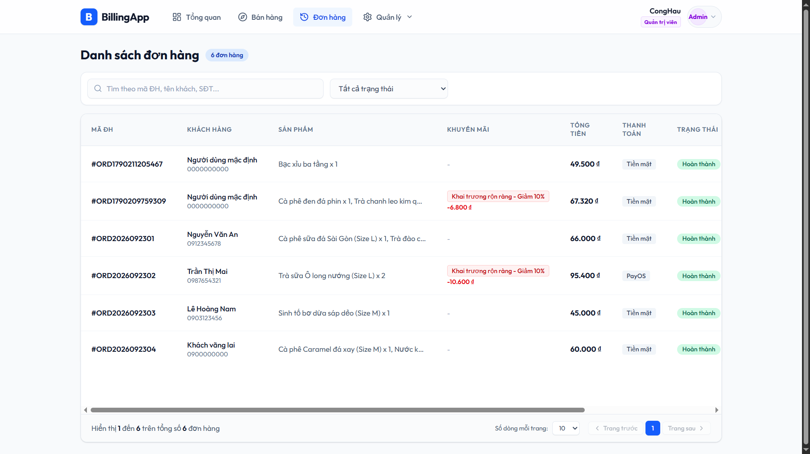 | 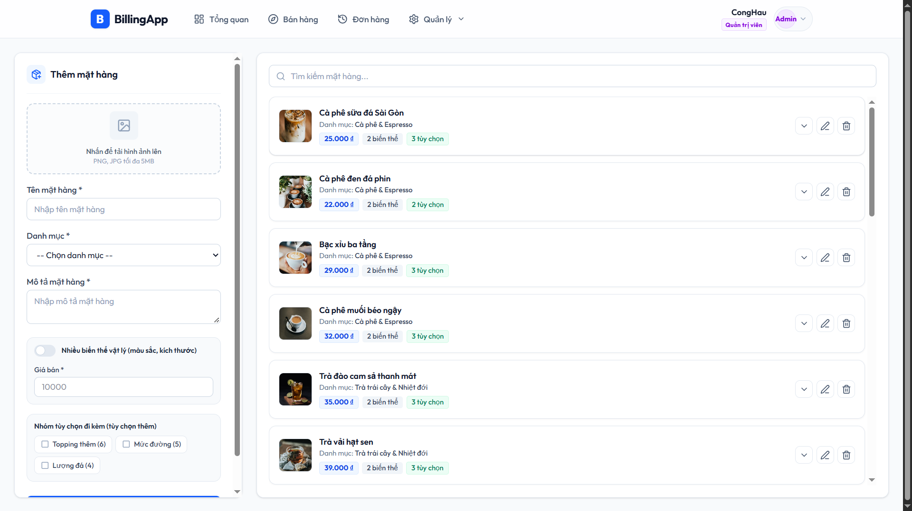 |
| *Tra cứu đơn hàng, lọc theo ngày/trạng thái và thực hiện hủy đơn hoàn kho* | *Quản lý sản phẩm, đơn giá, mã SKU và hình ảnh lưu trữ AWS S3* |

---

### 5. 🏷️ Danh mục, Tùy chọn Phụ (Modifiers) & Chương trình Khuyến mãi
Hỗ trợ cấu hình danh mục đa tầng, nhóm topping tùy chỉnh và các chính sách khuyến mãi (Coupon, Khung giờ vàng, BOGO) với thuật toán tự động áp dụng ưu đãi tốt nhất.

| 📂 Quản trị Danh mục | 🧋 Quản trị Nhóm tùy chọn (Topping) | 🎟️ Quản lý Khuyến mãi (Voucher) |
| :---: | :---: | :---: |
| 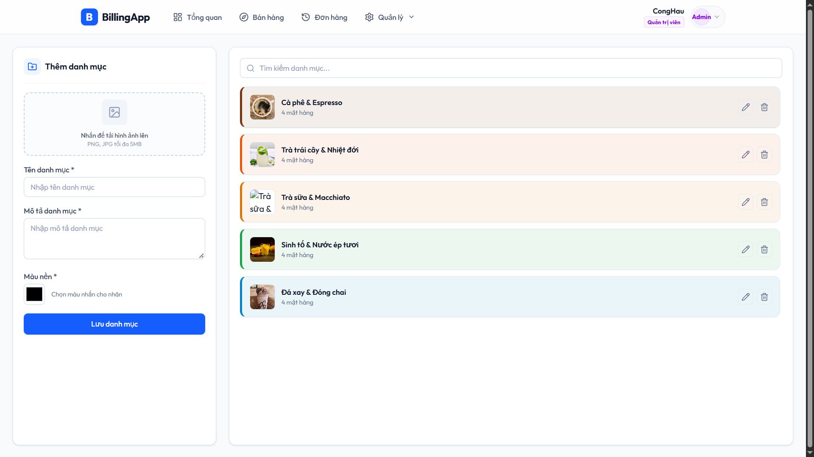 | 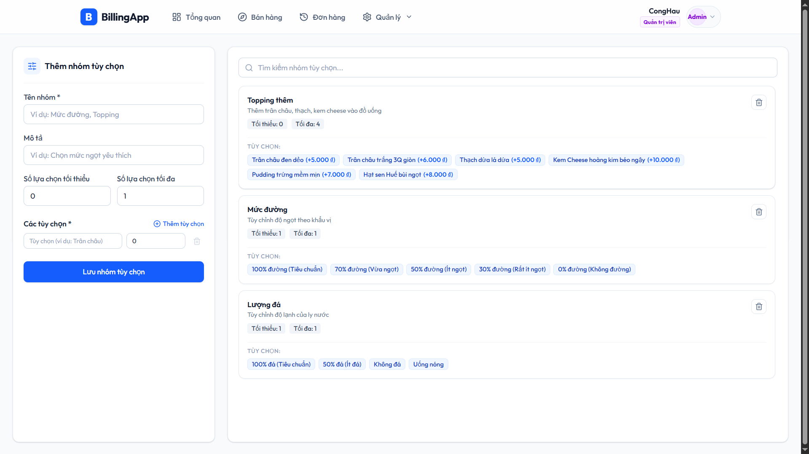 | 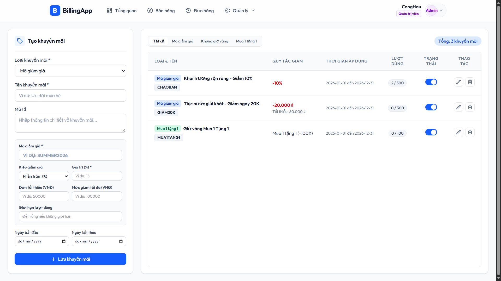 |
| *Phân loại các nhóm đồ uống, thức ăn* | *Thiết lập topping, kích cỡ và giá cộng thêm* | *Cấu hình mã Coupon, chiết khấu và giới hạn lượt dùng* |

---

### 6. 👥 Khách hàng (CRM), Phân quyền Nhân viên & Nhật ký Hoạt động (Audit Trail)
Quản trị dữ liệu khách hàng thân thiết, bảo mật phân quyền nhân viên theo mô hình RBAC và theo dõi nhật ký kiểm toán hệ thống toàn diện.

| 👤 Khách hàng thân thiết (CRM) | 🧑‍💼 Quản trị Người dùng & Phân quyền | 🛡️ Nhật ký Hoạt động (Audit Trail) | 🔐 Đăng nhập Xác thực JWT |
| :---: | :---: | :---: | :---: |
| 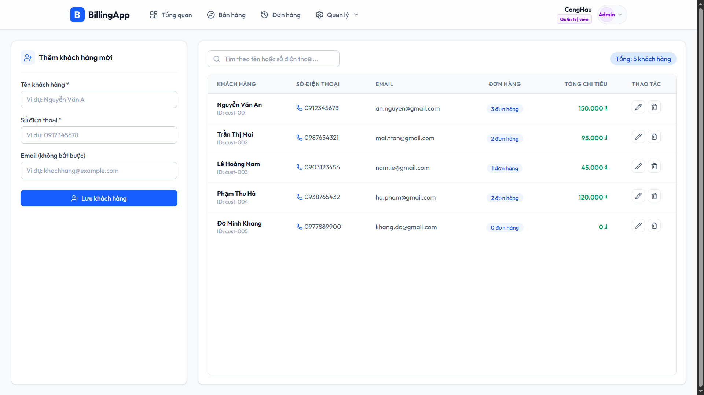 | 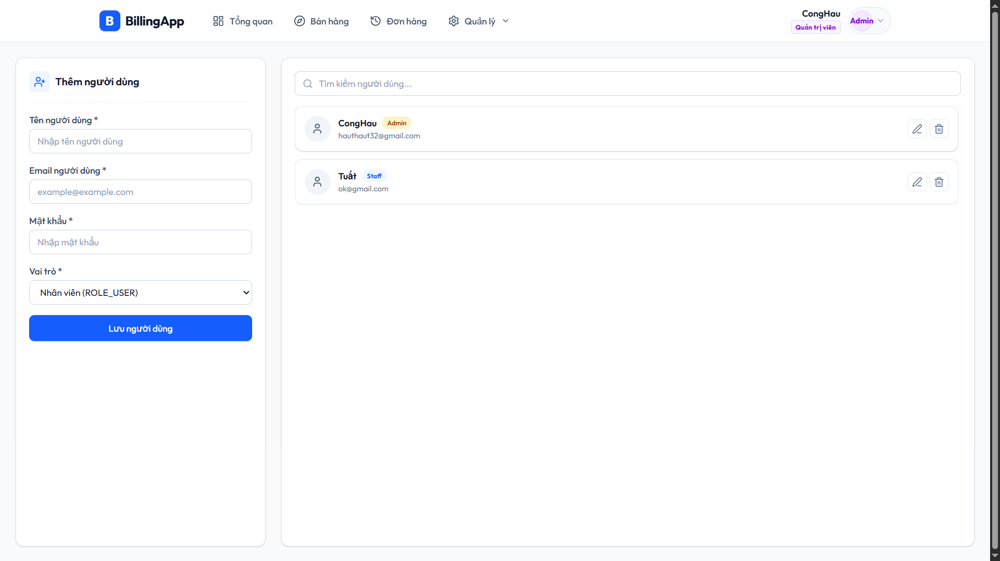 | 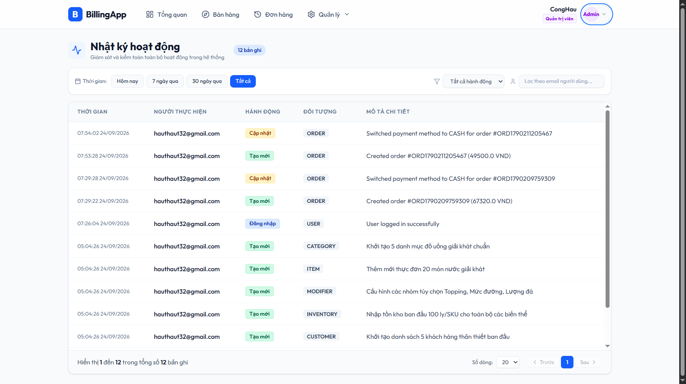 | 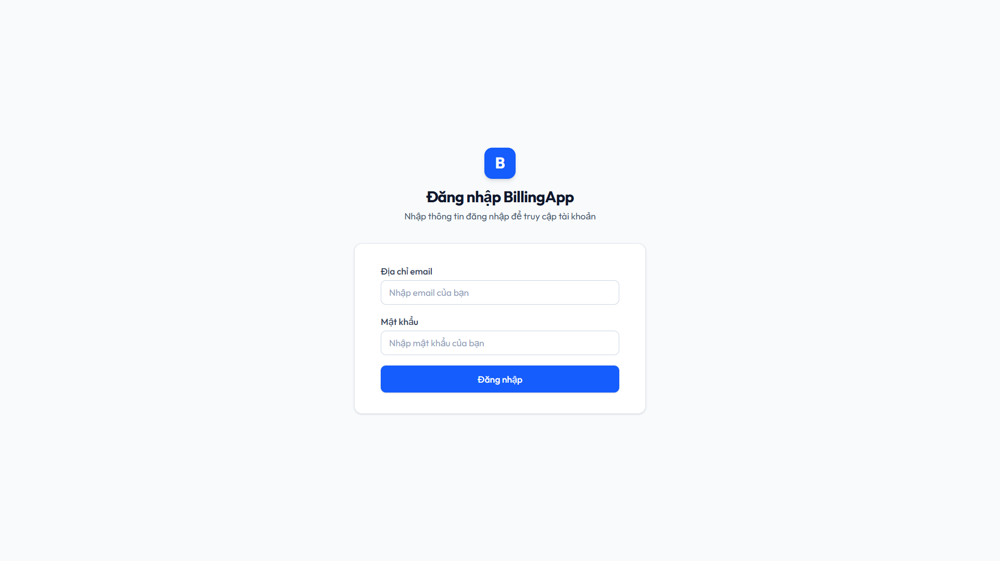 |
| *Quản lý danh bạ & tích điểm thành viên* | *Phân quyền tài khoản (ADMIN / STAFF)* | *Audit log ghi vết chi tiết tác vụ & thời gian* | *Bảo mật phiên đăng nhập với Access/Refresh Token* |

---

## 🏗 Kiến trúc Hệ thống (System Architecture)

Dự án được xây dựng theo kiến trúc Client-Server hiện đại, phân tách rõ ràng giữa Frontend SPA và Backend RESTful API:

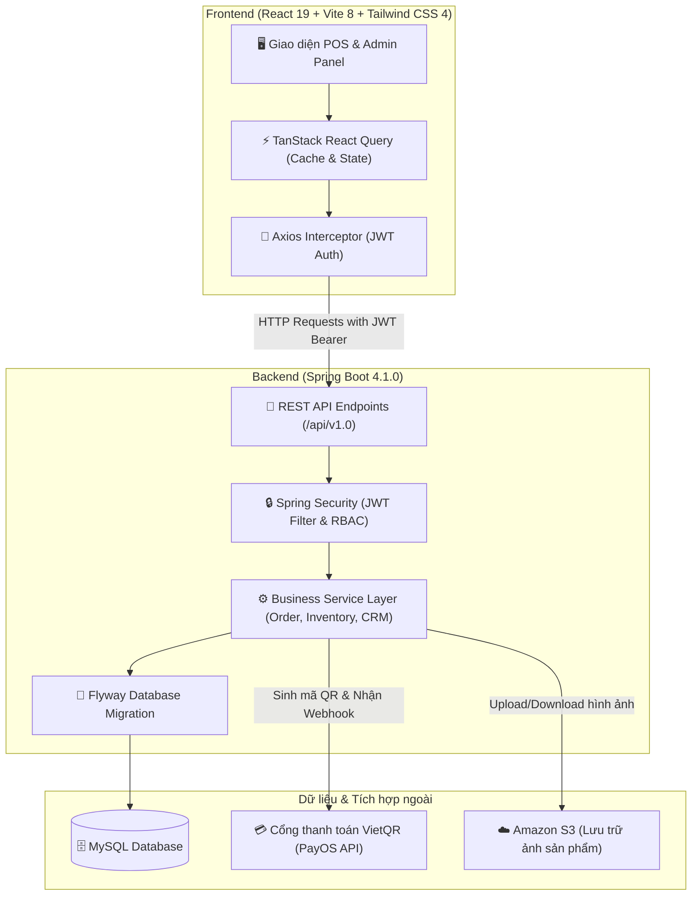

---

## ✨ Tính Năng Nổi Bật (Key Features)

- **🛍️ Bán hàng POS đa năng:** Giao diện tốc độ cao, hỗ trợ sản phẩm có nhiều biến thể (Variant / SKU) và tùy chọn đi kèm (Modifiers / Topping) với thuộc tính động dạng JSON.
- **💳 Cổng thanh toán VietQR PayOS:** Tạo mã QR tự động theo từng đơn hàng, tự động xác thực trạng thái thanh toán real-time qua Webhook, hỗ trợ chuyển đổi linh hoạt sang thanh toán tiền mặt.
- **📦 Quản lý kho dạng Sổ cái (Ledger Inventory):** Mọi giao dịch biến động số lượng đều được lưu vết dạng sổ cái (`IN`, `OUT`, `ADJUSTMENT`). Cho phép bán hàng ngay cả khi mất mạng tạm thời (chấp nhận tồn kho âm ngắn hạn) và tự động bù trừ hoàn kho khi hủy đơn hàng.
- **🎟️ Khuyến mãi thông minh (Anti-Stacking):** Hỗ trợ nhiều loại khuyến mãi (Coupon, Happy Hour, Giảm giá trực tiếp); hệ thống tự động tính toán và chọn 1 chương trình ưu đãi có lợi nhất cho khách hàng.
- **👥 Quản lý Khách hàng (CRM):** Lưu trữ thông tin khách hàng, số điện thoại, lịch sử chi tiêu và điểm tích lũy thành viên.
- **🛡️ Bảo mật & Nhật ký Kiểm toán (Audit Trail):**
  - Xác thực bằng cặp JWT: Access Token ngắn hạn lưu trong bộ nhớ và Rotating Refresh Token trong HttpOnly Cookie.
  - Phân quyền RBAC (`ROLE_ADMIN`, `ROLE_STAFF`).
  - Ghi vết mọi hoạt động CREATE, UPDATE, DELETE trên các thực thể quan trọng vào bảng nhật ký hoạt động (`tbl_activity_logs`).
- **☁️ Tích hợp Đám mây AWS S3:** Tự động tải lên, quản lý và phân phối hình ảnh mặt hàng tốc độ cao.

---

## 🛠 Công nghệ Sử dụng (Tech Stack)

### 1. Backend (`/billingsoftware`)
- **Ngôn ngữ:** Java 25
- **Framework chính:** Spring Boot 4.1.0
  - **Spring Web MVC:** Xây dựng hệ thống RESTful API chuẩn mực.
  - **Spring Data JPA:** Quản lý và giao tiếp cơ sở dữ liệu qua Hibernate ORM.
  - **Spring Security:** Kiểm soát xác thực (Authentication) và phân quyền vai trò (Authorization).
- **Cơ sở dữ liệu:** MySQL (thông qua `mysql-connector-j`).
- **Database Migration:** Flyway (`flyway-core`, `flyway-mysql`) quản lý version schema CSDL tự động.
- **Bảo mật & Xác thực:** JSON Web Token (JJWT 0.9.1) với mô hình xoay vòng Refresh Token.
- **Lưu trữ Cloud:** Amazon S3 SDK (`software.amazon.awssdk:s3`) phục vụ upload ảnh sản phẩm.
- **Cổng thanh toán:** PayOS Java SDK (`vn.payos:payos-java`) tạo mã VietQR và lắng nghe Webhook.
- **Công cụ hỗ trợ:** Project Lombok (giảm thiểu boilerplate code).

### 2. Frontend (`/Front-end`)
- **Thư viện lõi:** React 19
- **Build Tool:** Vite 8 (Hot Module Replacement tức thời).
- **Styling:** Tailwind CSS 4 (Utility-first CSS tối ưu hóa bundle size).
- **Data Fetching & Cache:** TanStack React Query v5 (quản lý server state, auto-refetch, cache).
- **Routing:** React Router DOM v7.
- **Quản lý Form:** React Hook Form (xử lý validation mượt mà, tối ưu re-render).
- **HTTP Client:** Axios (kèm Interceptor tự động gán Bearer Token và xử lý refresh token).
- **Thư viện UI/UX bổ trợ:**
  - `lucide-react`: Hệ thống icon hiện đại, đồng bộ.
  - `qrcode.react`: Render mã QR động phục vụ thanh toán.
  - `react-hot-toast`: Thông báo toast thân thiện, đẹp mắt.

### 3. Triển khai & DevOps
- Container hóa toàn bộ hệ thống bằng **Docker** & **Dockerfile** riêng biệt cho Backend và Frontend.
- Máy chủ web **Nginx** làm Reverse Proxy phục vụ Frontend React trên môi trường Production.

---

## 🚀 Hướng Dẫn Cài Đặt & Khởi Chạy (Quick Start)

### Yêu cầu tiên quyết
- **Java:** JDK 21 hoặc JDK 25
- **Node.js:** v18 trở lên & npm
- **Cơ sở dữ liệu:** MySQL Server 8.0+

---

### Bước 1: Cấu hình Cơ sở Dữ liệu & Môi trường
1. Tạo cơ sở dữ liệu MySQL mới (ví dụ: `billing_db`).
2. Cấu hình thông tin kết nối và API Key trong file `.env` hoặc `application.properties`:
   - `SPRING_DATASOURCE_URL=jdbc:mysql://localhost:3306/billing_db`
   - `SPRING_DATASOURCE_USERNAME=root`
   - `SPRING_DATASOURCE_PASSWORD=your_password`
   - `PAYOS_CLIENT_ID=your_payos_client_id`
   - `PAYOS_API_KEY=your_payos_api_key`
   - `PAYOS_CHECKSUM_KEY=your_payos_checksum_key`
   - `AWS_ACCESS_KEY=your_aws_access_key`
   - `AWS_SECRET_KEY=your_aws_secret_key`

---

### Bước 2: Khởi chạy Backend (Spring Boot)
Mở terminal tại thư mục `billingsoftware`:
```bash
cd billingsoftware

# Cài đặt dependency và khởi chạy API Server
./mvnw spring-boot:run
```
> *API Server sẽ chạy tại cổng mặc định: `http://localhost:8080/api/v1.0`*

---

### Bước 3: Khởi chạy Frontend (ReactJS)
Mở một terminal khác tại thư mục `Front-end`:
```bash
cd Front-end

# Cài đặt các gói thư viện
npm install

# Khởi chạy máy chủ phát triển
npm run dev
```
> *Truy cập ứng dụng tại trình duyệt: `http://localhost:5173`*

---

## 📁 Cấu Trúc Thư Mục Dự Án (Project Structure)

```plaintext
Billing-app/
├── billingsoftware/            # Mã nguồn Backend (Java Spring Boot)
│   ├── src/main/java/          # Controller, Service, Repository, DTO, Entity, Security
│   ├── src/main/resources/     # application.properties & db/migration (Flyway SQL)
│   ├── Dockerfile              # Dockerfile đóng gói Backend
│   └── pom.xml                 # Maven dependencies
├── Front-end/                  # Mã nguồn Frontend (React 19 + Vite)
│   ├── src/                    # Components, Pages, Services, Hooks, Utils
│   ├── public/                 # Assets tĩnh
│   ├── Dockerfile              # Dockerfile đóng gói Frontend
│   └── nginx.conf              # Cấu hình Web Server Nginx
├── images/                     # Bộ hình ảnh giao diện & chụp màn hình hệ thống
└── README.md                   # Tài liệu hướng dẫn & giới thiệu dự án
```

---

<p align="center">
  Được phát triển với niềm đam mê công nghệ và trải nghiệm người dùng tối ưu. ⭐ Hãy thả 1 Star nếu dự án hữu ích với bạn!
</p>
